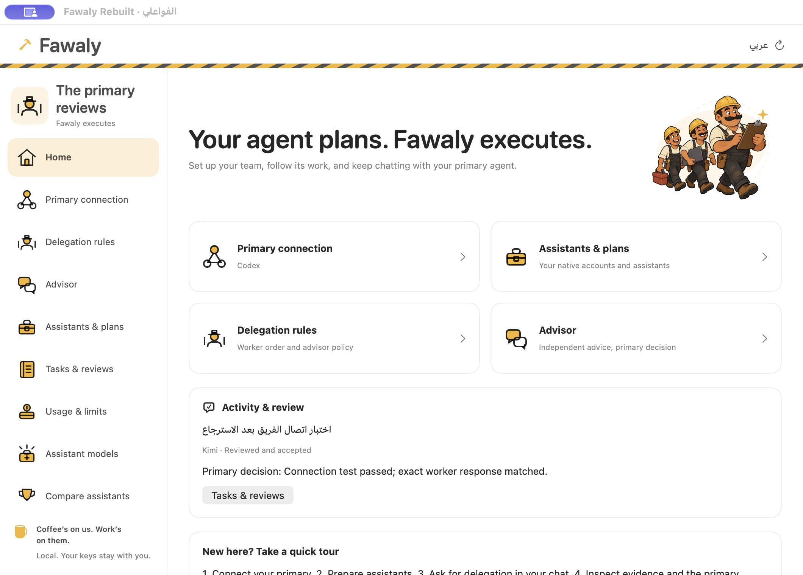
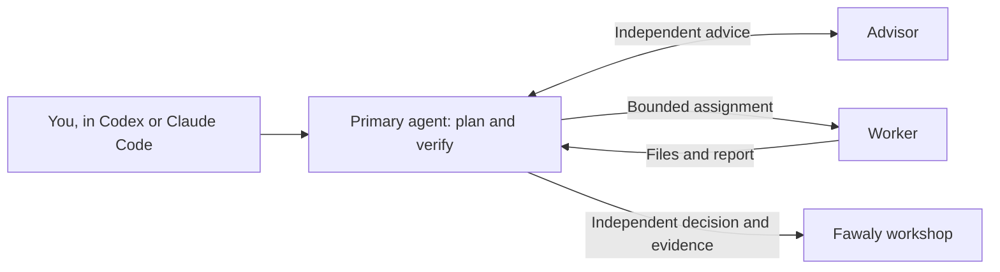
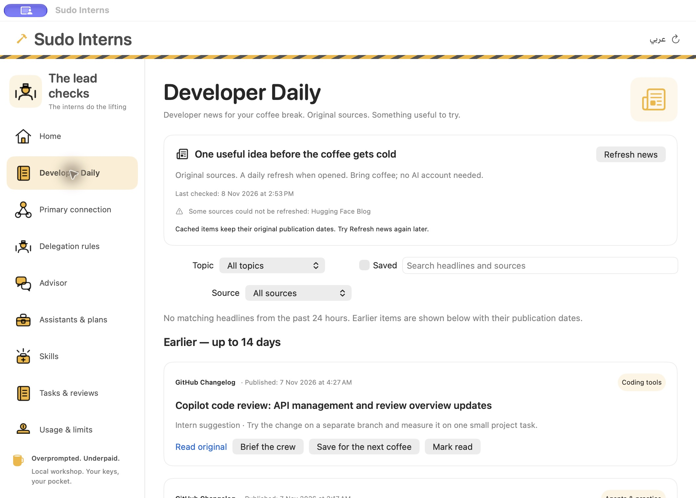

<div align="center">

# Sudo Interns · الفواعلي

**Overprompted. Underpaid.**<br>
**الكبير يخطّط. والفواعلي يشيلوا الشغل.**

A free, open-source macOS workshop for your AI coding crew. Your primary leads, an advisor questions the plan, and the interns do the lifting. Hard hats included. Independent review required.

[Download for Mac](https://github.com/daxowapp/fawaly/releases/tag/v0.7.0) · [Website](https://daxow.com/fawaly) · [العربية](#العربية) · [Get started](#get-started) · [Contribute](CONTRIBUTING.md) · [License](LICENSE)

[](https://github.com/daxowapp/fawaly/actions/workflows/macos.yml)


</div>



**English name: Sudo Interns. Arabic name: الفواعلي.** The name is a developer joke; the app does not grant administrator privileges to its assistants.

Keep working in your usual **Codex or Claude Code**. Sudo Interns connects an independent advisor and supporting workers through MCP. Your primary agent owns the plan, delegates bounded work, inspects the actual changes, runs checks, and records its decision.

**The official app is free and will remain free.** No app subscription, paid unlocks, or artificial feature tiers. AI provider accounts, subscriptions, and usage are separate and subject to each provider’s terms. The interns are free; their providers still keep a tab.

> **Public preview.** Apple notarized the direct Mac build. We tested it on the development Mac and ran 157 tests on each architecture in CI. Clean-Mac installation and a signed automatic upgrade still need verification. [Release notes](https://github.com/daxowapp/fawaly/releases/tag/v0.7.0) · [Readiness report](Docs/Production-Readiness.md).

## How the team works



| Role | Available assistants |
| --- | --- |
| Primary | Codex, Claude Code |
| Advisor | Native accounts plus configured API/local assistants |
| Worker | Native accounts plus configured API/local assistants |

An agent has one role in a saved team. A typical team is **Codex → Claude advisor + Kimi worker**. You can change roles in setup. Primary agents decide when to call tools; integrations cannot guarantee every model will always follow a policy.

## Get started

The signed, notarized preview supports macOS 14 or later on Apple Silicon and Intel Macs.

1. [Download the Mac ZIP](https://github.com/daxowapp/fawaly/releases/download/v0.7.0/Sudo-Interns-0.7.0.zip), unzip it, and move Sudo Interns to Applications. Open it from there.
2. Follow the Arabic or English setup: choose your primary, advisor, and workers.
3. Let Fawaly prepare the official supporting tools. Sign in through each provider’s own browser flow. No Terminal commands or pasted setup tokens.
4. Connect the team. Fawaly registers MCP in your primary agent’s user settings. Reopen that client or start a new chat if it cached its tools.
5. Choose a project folder when you want workers to edit files. Continue your work in your usual primary client.

For substantial tasks, the team instructions ask the primary to consult according to your advisor policy, delegate suitable bounded work, inspect the result independently, and save a review. Native client tool approvals still apply.

## Inside the workshop

- Native SwiftUI interface, English by default for new installations, Arabic/English switching, mirrored layout, light/dark/system appearance, and the original illustrated workshop identity. Existing language choices stay saved.
- **Developer Daily:** original publisher headlines, publication dates, source/topic filters, a local reading list, and practical prompts to review an idea with your crew. Refreshes once every 24 hours when opened; no automatic paid AI calls. [Sources, privacy and limits](Docs/Developer-Daily.md).
- Browser-based native account setup, connection checks, cancellation, sign-out, and saved team roles.
- Advisor policy, rounds and timeouts; ordered workers by task type; a 15-minute default worker timeout.
- Searchable tasks and reviews, live progress, stop controls, independent review evidence, and optional primary ratings.
- Isolated Git HEAD comparisons with two assistants. Your uncommitted files stay outside the snapshots. Selecting a winner never merges it automatically.
- Explicit supporting-agent model choices, a verified signed reference catalog, local activity counts, and settings export/import without credentials.
- Menu bar status, background monitoring after the window closes, optional launch at login, local notifications and morning account checks. Quitting stops monitoring.
- Folder-based preference sync suitable for iCloud Drive, with explicit approval of incoming settings and stale-revision protection. Credentials, roles, project grants and history remain local.
- Z.AI, MiniMax, DeepSeek, OpenRouter, custom OpenAI/Anthropic-compatible APIs, Ollama and LM Studio configuration through the UI and Keychain. Project tools have bounded reads and coordinated writes, no shell, and required primary review. Local request caps and provider-reported tokens are distinct from official account balances.

Configured API/local assistants appear in **Your accounts** alongside native accounts, with readiness, model and connection-management actions. The add-assistant list shows services that have not been configured yet. Saved, paused, and missing-key states are distinguished; appearing in this list does not automatically assign a team role.

The **Skills** page offers nine curated skills/templates with source credit, declared licenses, dated GitHub popularity, pinned revisions and per-file checksums. Each installation asks **all local projects** or **a specific project**, with a folder chooser. It previews the scope, overlaps and executable hooks before installation, detects existing skills, and appends attributed instruction sections while preserving older content and MCP/hook settings. Planning with Files provides on-disk project context; globally available skills still keep each project's memory separate. [Skills, scopes, compatibility and memory limits](Docs/Skills.md).



Daily news is a reading list, not an instruction to install everything that moves. **Brief the crew** prepares a source-review request for your usual agent; it does not silently spend your AI credits.

Services include official account/key or local setup links. OpenRouter supports browser PKCE sign-in or a manual key, plus a searchable live catalog of text/tool-capable models. OAuth-derived keys can be saved without a paid generation probe; Save & test is a separate explicit action. Requests use the user's OpenRouter credits, a selected model, and `provider.allow_fallbacks=false`; unrelated website subscriptions are not imported. See [OpenRouter OAuth](https://openrouter.ai/docs/guides/overview/auth/oauth) and [model catalog](https://openrouter.ai/docs/api/api-reference/models/get-models).

Subscription keys are provider-specific: MiniMax's M Plan/Coding Plan key is separate from its pay-as-you-go key ([official guide](https://platform.minimax.io/docs/m-plan/quickstart)). Z.ai's GLM Coding Plan provides a key under Personal Coding Plan → Plan Overview, but [restricts subscription use to supported tools](https://docs.z.ai/devpack/tool/others), including Claude Code and ZCode. Fawaly is not currently listed. Its direct Z.AI preset uses the standard, separately billed OpenAI-compatible API endpoint; it does not claim GLM subscription support or modify the user's Claude Code provider settings. Existing saved endpoints are preserved.
- Signed-update infrastructure and a universal Developer ID/notarization packaging script. Ad-hoc previews cannot self-update; see [distribution](Docs/Distribution.md).

Official subscription balances and dollar spending caps are unavailable. There is no automatic paid retry/fallback. Compatible APIs can list their models; Anthropic-compatible services keep the explicitly configured ID. New API adapters have fixture coverage; live cloud-provider verification requires the user’s keys and is not claimed. Complete old app/widget parity is not claimed. Account availability and local job counts are not quota measurements.

## Build and test

For repeat local development, [replace the one installed app](Docs/Development.md) instead of keeping old launchable copies.

Requires macOS 14+, full Xcode, and acceptance of Xcode’s license. Tested locally with Xcode 27.2. Sparkle 2.10.1 is pinned through Swift Package Manager; Xcode downloads the official binary package.

```sh
git clone https://github.com/daxowapp/fawaly.git
cd fawaly
xcodebuild -project "Fawaly Rebuilt.xcodeproj" -scheme "Fawaly Rebuilt" \
  -destination 'platform=macOS' -derivedDataPath Build/DerivedData \
  -parallel-testing-enabled NO test
```

To run from Xcode, select **Fawaly Rebuilt → My Mac → Run**. Keep the app at a stable location before connecting MCP. To use the optional `Engine/fawaly` developer launcher, copy the built app to `Build/Fawaly Rebuilt.app`:

```sh
ditto "Build/DerivedData/Build/Products/Debug/Fawaly Rebuilt.app" "Build/Fawaly Rebuilt.app"
```

The checked-in Xcode project is ready to open. When adding source files, regenerate it with the dependency-free script:

```sh
ruby Scripts/generate-project.rb "$PWD"
```

Do not commit downloaded runtimes, local builds, account data, or your project files. Native providers are downloaded separately from their official sources and retain their own licenses. See [architecture and privacy](Docs/Architecture.md).

## Free forever, with shared improvements

Our maintainer commitment: **the official Fawaly app remains free**. The code is licensed **AGPL-3.0-or-later**. You may use, study, modify, and share it. When conveying covered modified software, provide corresponding source under the license; modified network-facing versions must offer corresponding source to their remote users as required by section 13.

Private modifications do not automatically require a public repository, and the license does not require an upstream pull request. We warmly encourage sharing improvements here for everyone. AGPL permits commercial use and charging for copies; our free-app pledge concerns the official project and does not restrict those freedoms. The full [license](LICENSE) controls.

## العربية

الفواعلي بيخلّيك تكمّل شغلك داخل Codex أو Claude Code المعتاد. الأجنت الأساسي يخطّط ويراجع، مستشار مستقل يدّي رأي تاني، والفواعلي ينفّذوا مهام محددة. مثال: Codex أساسي، Claude مستشار، وKimi عامل.

**نسخة الفواعلي الرسمية مجانية وهتفضل دائمًا مجانية**؛ من غير اشتراك للفواعلي أو قفل للمميزات خلف باقات. اشتراكات واستخدام خدمات الذكاء الاصطناعي مستقلة وبتخضع لشروط أصحابها.

التجهيز بيتم من واجهة التطبيق: اختيار الفريق، تجهيز الأدوات الرسمية، تسجيل دخول من متصفح الخدمة، وربط الفريق. المستخدم العادي مش محتاج يكتب أوامر Terminal. تختار فولدر المشروع عشان تسمح للعمال بتعديله، والأساسي لازم يراجع الشغل قبل اعتماده.

النسخة التجريبية العامة موقّعة وموثّقة من Apple، وتشتغل على macOS 14 أو أحدث. فك الضغط وانقل Sudo Interns لفولدر Applications وافتحه من هناك. [نزّل نسخة الماك](https://github.com/daxowapp/fawaly/releases/tag/v0.7.0).

الرخصة AGPLv3 أو أحدث بتضمن حقوق الاستخدام والتعديل والمشاركة، وبترجع حق الوصول للمصدر لمستخدمي النسخ الموزعة والخدمات المعدّلة حسب شروطها. بنشجّع كل تحسين يرجع هنا للمجتمع؛ إرسال Pull Request مش شرط إجباري في الرخصة، والتعديلات الخاصة مش لازم تتحول تلقائيًا لمشروع عام.

## Help build it

Useful bug reports, accessible Arabic copy, onboarding feedback, security reviews, tests, and small focused fixes all help. Read [CONTRIBUTING.md](CONTRIBUTING.md), [CODE_OF_CONDUCT.md](CODE_OF_CONDUCT.md), and [SECURITY.md](SECURITY.md). Please remove credentials and private project content from reports.

Original idea and name: **[Ahmed Nagdy — أحمد نجدي](https://nagdy.me/)**. We developed and expanded his idea into a native Mac app; our thanks for the original idea and name. Development and reconstruction: **Daxow and contributors**. This is an independent project, not an official OpenAI, Anthropic, or Moonshot product. Provider names and trademarks belong to their owners. [Third-party notices](THIRD_PARTY_NOTICES.md).
